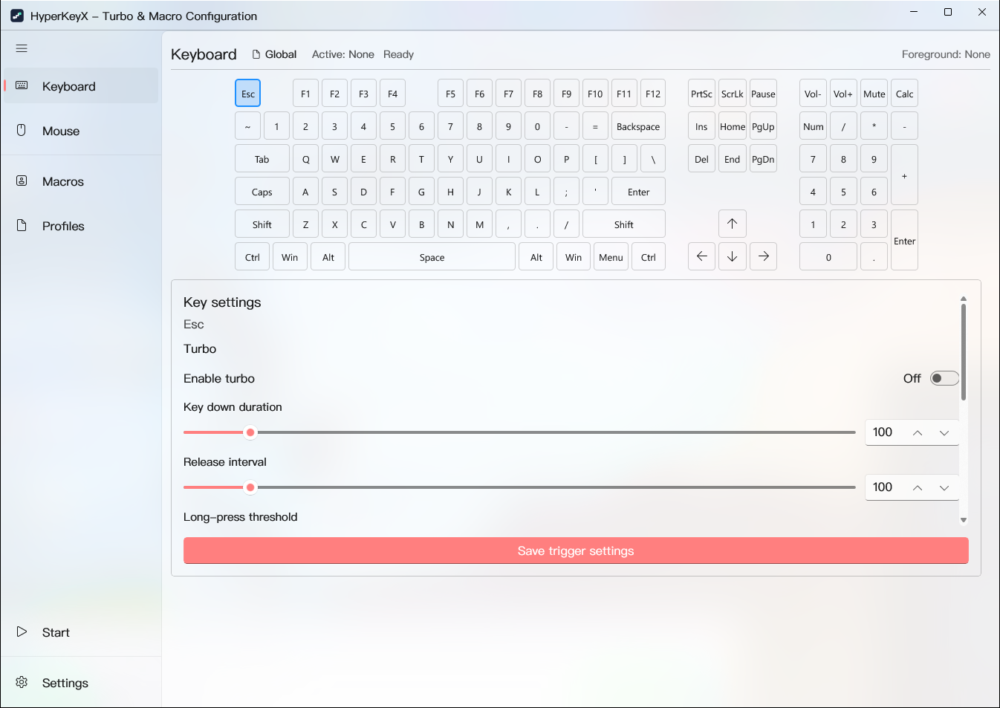
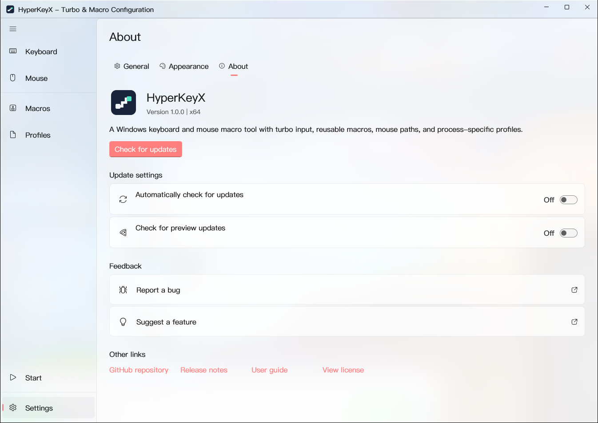
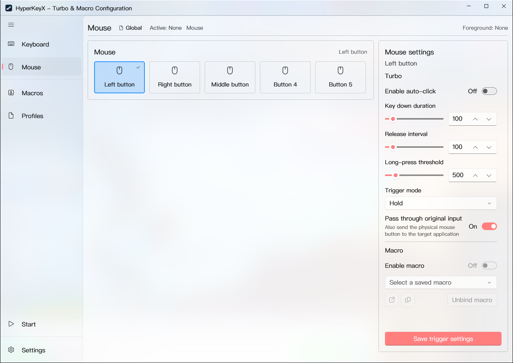
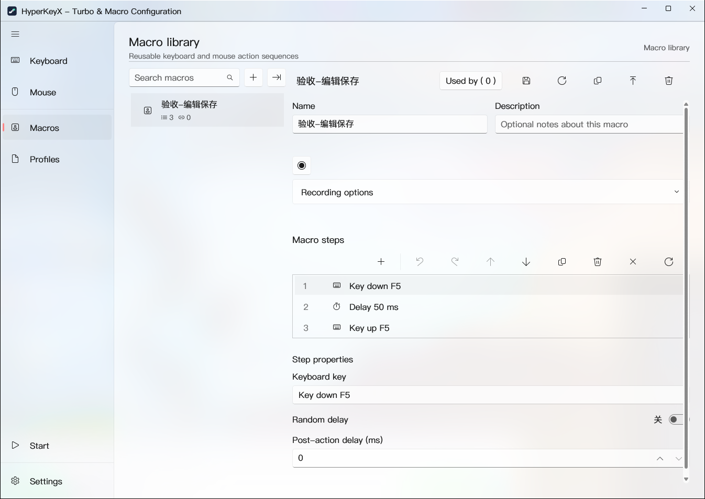

<p align="center">
  
</p>
<h1 align="center">HyperKeyX</h1>
<p align="center">Keyboard and mouse macros, built for Windows.</p>
<p align="center">
  <a href="README.md"><strong>English</strong></a> · <a href="README.zh-CN.md">简体中文</a>
</p>
<p align="center">
  <a href="https://github.com/ChikuraXX/HyperKeyX/releases"></a>
  <a href="LICENSE"></a>
</p>
<p align="center">
  <a href="https://github.com/ChikuraXX/HyperKeyX/releases"></a>
  <a href="#getting-started"></a>
  <a href="https://github.com/ChikuraXX/HyperKeyX/issues"></a>
</p>

HyperKeyX brings keyboard turbo, reusable macros, mouse paths, and process-specific profiles together in a Windows desktop app. Create and save automation locally, then reuse it across your keyboard and mouse bindings. No account is required.

## Features

| Capability | What you can do |
| --- | --- |
| **Keyboard & mouse bindings** | Bind keys and mouse buttons to macros using hold, toggle, or long-press triggers. |
| **Turbo input & timing** | Configure key-down duration, release intervals, long-press thresholds, and uniform or normal random macro delays. |
| **Reusable macro library** | Record, edit, search, duplicate, import, and export macros. Reuse one saved macro across multiple profiles. |
| **Mouse paths** | Capture key points or continuous movement with relative, desktop, or target-window coordinates. Adjust timing and speed. |
| **Profiles** | Keep a global configuration or use process-specific profiles for different applications. |
| **Windows integration** | Use the tray, startup options, notifications, themes, fonts, and interface scaling. Switch between Chinese and English and customize global shortcuts. |

## Screenshots

<table>
  <tr>
    <th width="50%">Keyboard configuration</th>
    <th width="50%">About & updates</th>
  </tr>
  <tr>
    <td><a href="docs/screenshots/keyboard-en.png"></a></td>
    <td><a href="docs/screenshots/settings-en.png"></a></td>
  </tr>
  <tr><th>Mouse configuration</th><th>Reusable macros</th></tr>
  <tr>
    <td><a href="docs/screenshots/mouse-en.png"></a></td>
    <td><a href="docs/screenshots/macros-en.png"></a></td>
  </tr>
</table>

## Getting started

1. Download `HyperKeyX-<version>-win-x64.zip` from [Releases](https://github.com/ChikuraXX/HyperKeyX/releases), extract the complete archive to a folder, then run `HyperKeyX.exe`.
2. Open **Keyboard** or **Mouse**, then select the key or button you want to configure.
3. Configure turbo input, or create a macro in **Macros**, save it, and select it in the trigger settings.
4. Save the trigger configuration, then use the **Start** control in the navigation pane to enable automation.

Use **Profiles** to organize bindings for different applications. Macro editing, configuration storage, and execution stay on your computer.

## Downloads & support

This release is distributed as a ZIP archive. **In-app update checks, downloads, and installation are temporarily disabled**, including startup checks. Get new versions from [GitHub Releases](https://github.com/ChikuraXX/HyperKeyX/releases). The repository, release history, and feedback links remain available in **Settings → About**.

The in-app update implementation remains in the source but is disabled. MSI installer files and tooling are not included in this repository or its source archives.

## Requirements & building

Requires Windows 10 version 2004 (build 19041) or later, x64. The ZIP uses framework-dependent deployment: install the [x64 .NET 10 Runtime](https://dotnet.microsoft.com/download/dotnet/10.0), [VC++ v14 x64 Redistributable](https://aka.ms/vc14/vc_redist.x64.exe), and [Windows App Runtime 2.2 x64 or a compatible newer 2.x runtime](https://learn.microsoft.com/windows/apps/windows-app-sdk/downloads) before running the app. These shared runtimes are not included in the archive.

Building from source requires .NET SDK 10 and a Windows build environment.

```powershell
dotnet restore HyperKeyX.slnx
dotnet build src/HyperKeyX.App/HyperKeyX.App.csproj -c Release -p:Platform=x64
# Create a non-self-contained application ZIP; this does not publish it.
./scripts/Build-Zip.ps1 -Version 1.0.1
# Preview example:
./scripts/Build-Zip.ps1 -Version 1.0.2-preview.1 -OutputDirectory artifacts/zip-preview
```

The application archive and `SHA256SUMS.txt` are written to `artifacts/zip`. Extract the complete archive before launching; keep the adjacent assemblies, resources, and license files together. App settings and macros continue to use the existing local application data directory.

| Channel | Source branch | Tag | GitHub Release |
| --- | --- | --- | --- |
| Stable | `master` | `v1.0.1` | Latest stable |
| Preview | `test` | `v1.0.2-preview.1` | Pre-release; does not replace Latest |

The release workflow builds a ZIP, SHA-256 checksums, and a clean source archive. Publishing validates that the tag points to the build commit on the corresponding remote branch. Manual runs build candidates by default; publishing requires explicitly selecting the publish option and an existing matching tag.

Prepare a source-only upload locally with `./scripts/Export-PublishSource.ps1 -OutputDirectory artifacts/publish-source-zip`. The export retains source, ZIP build scripts, documentation, licenses, and screenshots, while excluding compiled outputs, caches, local settings, and verification artifacts.

## License

[GNU LGPL v3.0 only](LICENSE) (`LGPL-3.0-only`). Commercial use is allowed under the license terms. Third-party components retain their respective licenses. The full terms are included in [COPYING.LESSER](COPYING.LESSER) and [COPYING](COPYING). See also the [third-party notices](ThirdPartyNotices/CommunityToolkit.Windows.MIT.txt).
