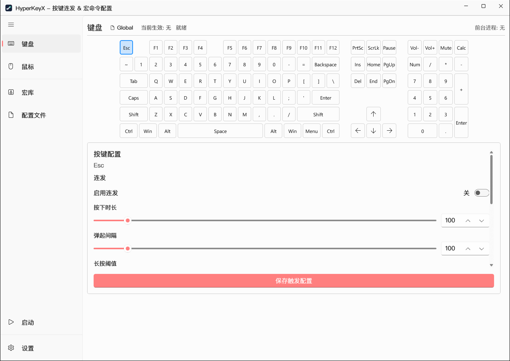
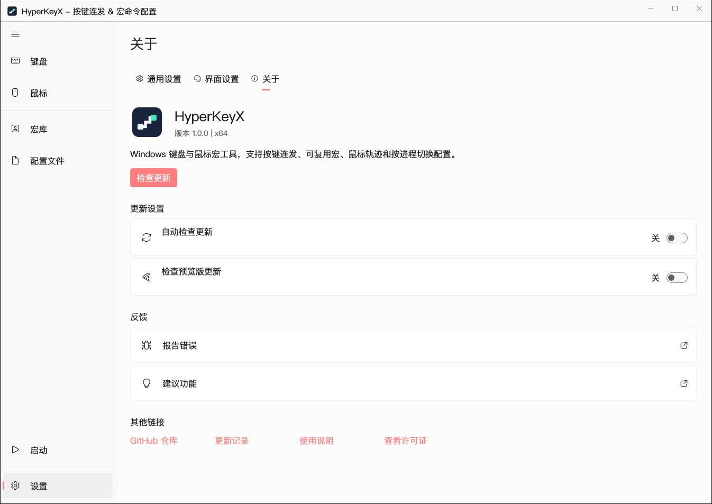
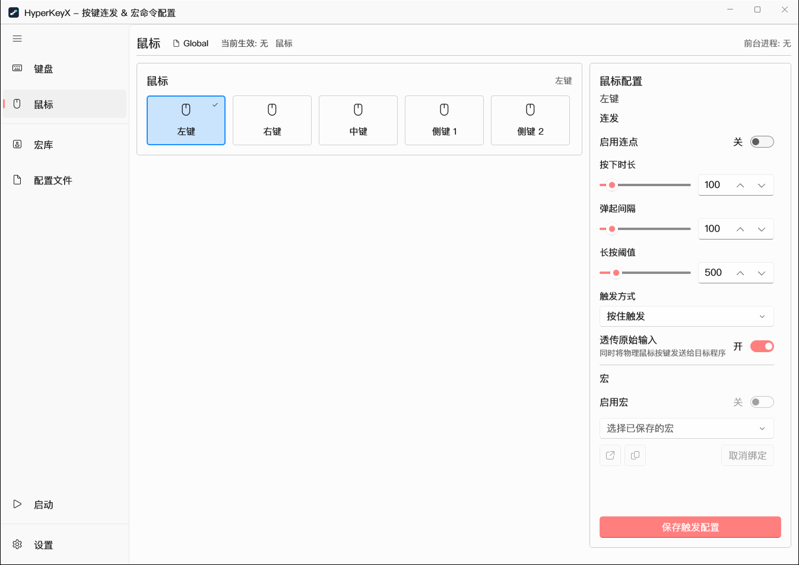
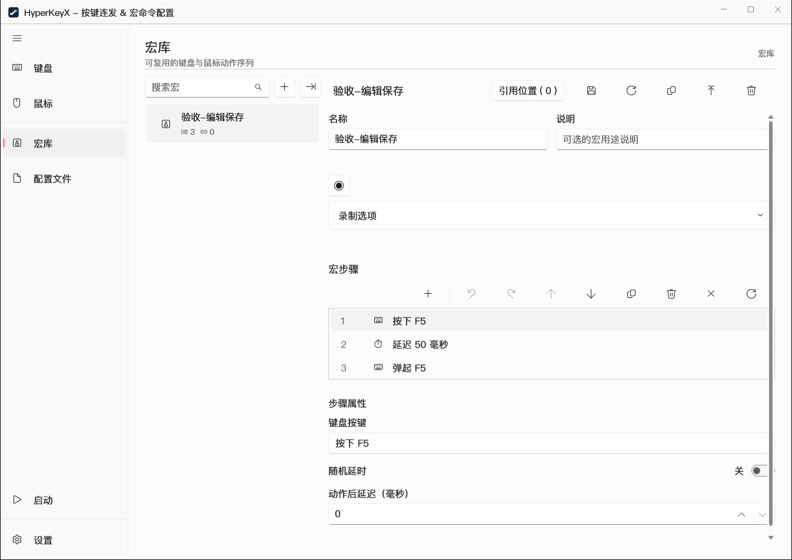

<p align="center">
  
</p>
<h1 align="center">HyperKeyX</h1>
<p align="center">让键盘与鼠标，按你的方式工作。</p>
<p align="center">
  <a href="README.md">English</a> · <a href="README.zh-CN.md"><strong>简体中文</strong></a>
</p>
<p align="center">
  <a href="https://github.com/ChikuraXX/HyperKeyX/releases"></a>
  <a href="LICENSE"></a>
</p>
<p align="center">
  <a href="https://github.com/ChikuraXX/HyperKeyX/releases"></a>
  <a href="#快速开始"></a>
  <a href="https://github.com/ChikuraXX/HyperKeyX/issues"></a>
</p>

HyperKeyX 是一款 Windows 键盘与鼠标宏工具，将按键连发、可复用宏、鼠标轨迹与按进程切换的配置集中在一个桌面应用中。录制、编辑并保存动作后，即可在不同按键和配置之间复用，无需注册账号。

## 功能一览

| 功能 | 可以做什么 |
| --- | --- |
| **键盘与鼠标绑定** | 为按键和鼠标按钮绑定宏，支持按住、切换和长按触发。 |
| **按键连发与延迟** | 设置按下时长、弹起间隔和长按阈值，宏延迟支持均匀或正态随机分布。 |
| **可复用宏库** | 录制、编辑、搜索、复制及导入导出宏，让同一个已保存宏供多个配置使用。 |
| **鼠标轨迹** | 录制关键点或连续移动，选择相对、桌面或目标窗口坐标，调整时间与速度。 |
| **配置文件** | 使用全局配置，也可为不同应用分别配置触发规则。 |
| **Windows 集成** | 设置托盘、开机启动、通知、主题、字体与缩放，支持中文和英文界面，以及自定义全局快捷键。 |

## 软件截图

<table>
  <tr>
    <th width="50%">键盘配置</th>
    <th width="50%">关于与更新</th>
  </tr>
  <tr>
    <td><a href="docs/screenshots/keyboard-zh-CN.png"></a></td>
    <td><a href="docs/screenshots/settings-zh-CN.png"></a></td>
  </tr>
  <tr><th>鼠标配置</th><th>可复用宏库</th></tr>
  <tr>
    <td><a href="docs/screenshots/mouse-zh-CN.png"></a></td>
    <td><a href="docs/screenshots/macros-zh-CN.png"></a></td>
  </tr>
</table>

## 快速开始

1. 从 [Releases](https://github.com/ChikuraXX/HyperKeyX/releases) 下载 `HyperKeyX-<版本>-win-x64.zip`，完整解压到一个文件夹，再运行 `HyperKeyX.exe`。
2. 打开“键盘”或“鼠标”，选择需要配置的按键或按钮。
3. 设置连发参数；需要执行多步动作时，在“宏库”中创建并保存宏，再回到触发设置中选择它。
4. 保存触发配置，通过导航栏中的“启动”入口启用自动化。

需要区分不同应用时，可在“配置文件”中管理各自的绑定。宏编辑、配置保存和执行均在本机完成。

## 下载与支持

当前版本使用 ZIP 压缩包分发，**应用内更新检查、下载和安装暂不启用**，启动时也不会检查。新版本请前往 [GitHub Releases](https://github.com/ChikuraXX/HyperKeyX/releases) 下载。“设置 → 关于”中的仓库、更新记录与反馈入口继续可用。

应用内更新实现保留在源码中，继续停用；MSI 安装器及其专用工具不包含在此仓库和源码附件中。

## 运行要求与构建

支持 Windows 10 2004（19041）或更高版本，x64 架构。ZIP 采用非自包含发布，运行前需要安装 [x64 .NET 10 Runtime](https://dotnet.microsoft.com/download/dotnet/10.0)、[VC++ v14 x64 运行库](https://aka.ms/vc14/vc_redist.x64.exe) 与 [Windows App Runtime 2.2 x64 或兼容的更高稳定版 2.x 运行时](https://learn.microsoft.com/windows/apps/windows-app-sdk/downloads)。压缩包不内附这些共享运行时。

从源码构建需要 .NET SDK 10 和 Windows 构建环境。

```powershell
dotnet restore HyperKeyX.slnx
dotnet build src/HyperKeyX.App/HyperKeyX.App.csproj -c Release -p:Platform=x64
# 生成非自包含程序 ZIP，不执行发布。
./scripts/Build-Zip.ps1 -Version 1.0.1
# 预览版示例：
./scripts/Build-Zip.ps1 -Version 1.0.2-preview.1 -OutputDirectory artifacts/zip-preview
```

程序压缩包和 `SHA256SUMS.txt` 输出到 `artifacts/zip`。请完整解压后启动，保留同目录中的程序集、资源及协议文件。软件设置和宏继续使用原有的本地应用数据目录。

| 通道 | 源码分支 | 标签示例 | GitHub Release |
| --- | --- | --- | --- |
| 稳定版 | `master` | `v1.0.1` | 最新稳定版 |
| 预览版 | `test` | `v1.0.2-preview.1` | Pre-release，不覆盖 Latest |

发布工作流生成 ZIP、SHA-256 校验清单和干净源码压缩包。发布时会核对标签精确指向当前构建提交，且提交属于对应远程分支。手动运行默认只生成候选产物；只有明确开启发布选项且已有匹配标签，才会发布。

本地准备仅含必要源码的上传目录，可运行 `./scripts/Export-PublishSource.ps1 -OutputDirectory artifacts/publish-source-zip`。导出保留源码、ZIP 构建脚本、说明、协议和截图，排除编译产物、缓存、本地设置及验证材料。

## 许可证

采用 [GNU LGPL v3.0 only](LICENSE)（`LGPL-3.0-only`），允许遵循协议的商业使用。第三方组件保留各自许可。完整条款见 [COPYING.LESSER](COPYING.LESSER) 和 [COPYING](COPYING)，以及 [第三方许可声明](ThirdPartyNotices/CommunityToolkit.Windows.MIT.txt)。
